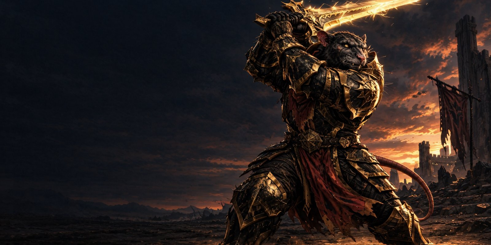
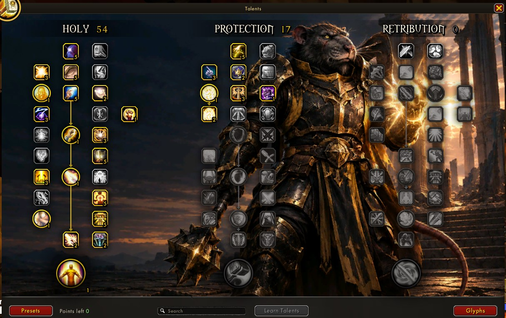
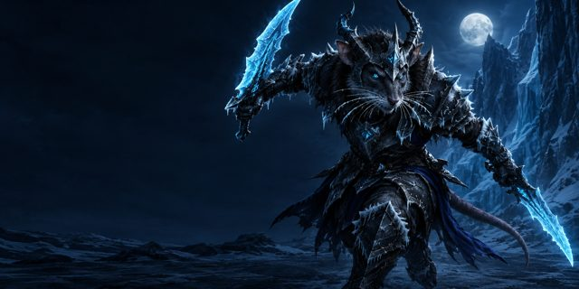
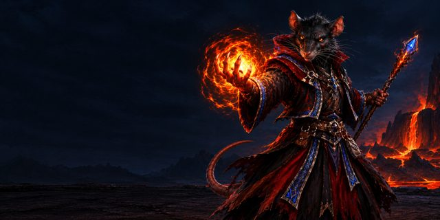
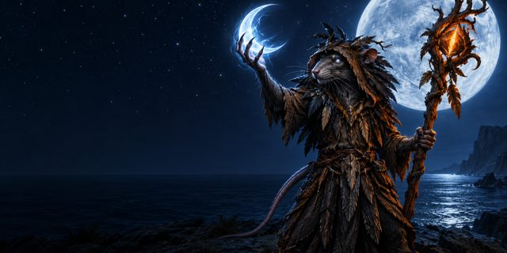
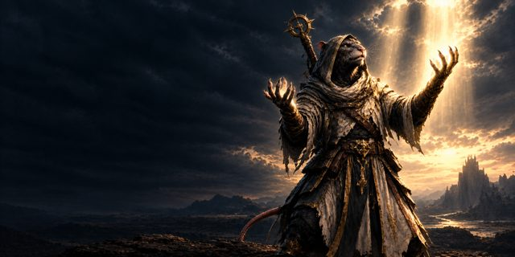

  

  <b>Talents and glyphs for World of Warcraft 3.3.5a.</b> 
  Plan every point first, then learn them all at once. No more misclicks during a respec.

  
  
  
  

---

  

### Why another talent window

The default talent frame spends a point the moment you click. One misclick during a respec and the
point is gone until the next trainer visit. Ratree lets you build the whole tree first, change your
mind as often as you like, and only spend the points when you press **Learn Talents**.

## Features

| | |
|---|---|
| **Plan, then learn** | Left click adds a point, right click takes it back. Nothing is spent until **Learn Talents (N)**, which shows how many points are planned. **Discard** throws the plan away. |
| **Presets** | Save a build ("Frost DK", "Blood Tank") and apply it later, for example on a freshly reset dual spec. Presets are kept per class and shared by every character of that class. |
| **Both specs** | Square tabs on the window's edge show each spec's main tree. Browse the other one and switch to it, with a cast bar in the footer while the switch casts. |
| **Hunter pets** | The pet tree has its own tab. |
| **Inspect** | The inspect window's Talents tab opens the other player's trees here, kept steady even when your tooltip addons inspect someone else on mouseover. |
| **Glyphs** | Three major and three minor sockets on a gold star, each showing the icon of the ability it changes, with every active glyph listed beside them. |
| **Search** | Type a talent's name and every match pulses gold. |
| **Look** | The newer game's talent frames: passive talents square, abilities round, the last talent larger, arrows between requirements. |

## Artwork

Behind your trees stands the rat of the spec you have the most points in, painted for Ratree in the
RATS guild style. Specs without their own rat yet show their class rat.

  
  
  
  

## Install

1. Download **Ratree.zip** from the latest release.
2. Unzip it into `World of Warcraft\Interface\AddOns\`, so the folder is named **`Ratree`**.
3. Turn off other talent addons (Talented…). If one is still on, Ratree asks which one to keep.
4. Restart the game.

## Use

| | |
|---|---|
| `N` or the talent button | open your talents |
| the glyph key | open your glyphs |
| `/ratree` · `/rtree` | toggle the window |
| `/ratree glyphs` | open the glyph page |
| `/ratree scale 0.85` | resize the window (0.5 – 1.5) |
| **Left / right click** a talent | plan a point / take it back |
| **Shift-click** a talent | link it in chat |

WotLK can't take back a learned point: to apply a preset over a different build, reset your talents at
your class trainer first. Talents can't be learned in combat.

## Credits

Made by **Okanor** for the RATS guild. The talent window follows the work of
[DragonUI](https://github.com/NeticSoul/DragonUI); see [THIRD_PARTY_NOTICES](THIRD_PARTY_NOTICES.md).

## License

© 2026 Okanor. All rights reserved. Everyone is welcome to read the code, download Ratree and play
with it. Want to change something? Send a pull request — see [CONTRIBUTING](CONTRIBUTING.md).
Publishing your own modified version or re-uploading it elsewhere needs the author's permission —
see [LICENSE](LICENSE).
